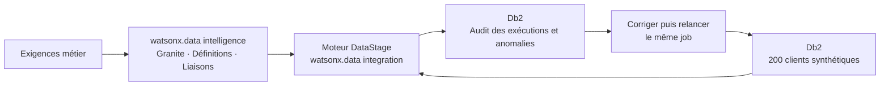

# IBM Cloud — lab de qualité des données

Reproduire la dernière démonstration **demo-v2** : 200 clients synthétiques, 20 exigences métier, proposition SQL avec Granite, définitions réutilisables, exécution native puis correction et vérification avec le même job.

**[Commencer le tutoriel pas à pas en français →](LAB.fr.md)**

| Résultat attendu | Avant correction | Après correction |
|---|---:|---:|
| Clients testés | 200 | 200 |
| Violations règle/client | 55 | 0 |
| Clients distincts concernés | 48 | 0 |

## Parcours



La proposition SQL Granite est relue et testée. Les vingt exigences sont exécutées à partir de neuf définitions natives. Le moteur d’exécution de ce parcours SaaS est DataStage ; les règles se définissent et se suivent dans watsonx.data intelligence.

## Préparer les fichiers

Python 3.9 ou ultérieur suffit, sans bibliothèque supplémentaire. Ces commandes préparent et vérifient les fichiers locaux ; elles ne créent aucun service Cloud.

```sh
gh repo clone XReyRobert-IBM/ibm-data-quality-lab-share
cd ibm-data-quality-lab-share
python3 scripts/validate_fixture.py
python3 scripts/prepare_lab.py --schema VOTRE_SCHEMA_DB2
```

Remplacer `VOTRE_SCHEMA_DB2` par le schéma réellement disponible dans votre base. Le [tutoriel](LAB.fr.md) explique la création des ressources, le chargement des fichiers `local/prepared/` et les opérations dans l’interface IBM.

## Fichiers utiles

- [LAB.fr.md](LAB.fr.md) : toutes les étapes depuis IBM Cloud jusqu’à la vérification après correction.
- [data/](data/) : données synthétiques initiales et corrigées, formats et 47 corrections documentées.
- [rules/](rules/) : contrat des vingt exigences, neuf expressions natives, liaisons et instruction Granite.
- [sql/](sql/) : modèles SQL ; exécuter les versions adaptées dans `local/prepared/`.
- [scripts/](scripts/) : préparation du schéma, découverte de vos identifiants et rapprochement de vos exports.

Le répertoire `local/` est ignoré par Git : il reçoit les SQL préparés, votre configuration d’exécution et vos exports. Le dépôt démarre avec un historique indépendant et contient uniquement le nécessaire à la reproduction du lab.

Les résultats natifs de référence ont été vérifiés les **15 et 16 octobre 2026**. Utiliser vos propres ressources, schéma et identifiants. Les scripts de partage ont été vérifiés localement sur les exports de référence. Une nouvelle exécution Cloud doit être validée dans votre compte.
